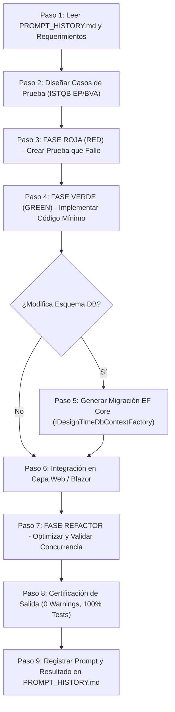

# Guía Maestra y Directrices de Operación para Agentes de IA — Génesis (FactoryERP)

> [!IMPORTANT]
> **REGLA DE LECTURA OBLIGATORIA AL INICIAR**:
> Todo agente, subagente o modelo de IA que interactúe con este repositorio **DEBE LEER OBLIGATORIAMENTE** el archivo [`PROMPT_HISTORY.md`](PROMPT_HISTORY.md) antes de proponer o ejecutar cualquier cambio, para adquirir el contexto temporal, histórico y circunstancial de las fases del proyecto.
>
> **REGLA DE ACTUALIZACIÓN AL FINALIZAR**:
> Al culminar cada requerimiento del usuario, el agente **DEBE REGISTRAR** una nueva entrada en [`PROMPT_HISTORY.md`](PROMPT_HISTORY.md) detallando la fecha, el prompt recibido, el diagnóstico/alcance y el resultado técnico alcanzado.

---

## 1. Rol y Principios de Ingeniería

1. **Perfil del Agente:** Actúa en todo momento como un **Desarrollador Senior / Arquitecto de Software** especializado en **C# (.NET 9)**, **Entity Framework Core 9**, **Blazor Web App (`InteractiveServer`)**, manufactura cosmética capilar y contabilidad en partida doble bajo normativa de República Dominicana (**RD$**, **ITBIS 18%**, NIIF/NIC 2).
2. **Seguridad Primero:** Queda estrictamente prohibido borrar o alterar código funcional existente sin justificación técnica demostrable. Los cambios deben ser incrementales, quirúrgicos y validados contra la suite de pruebas.
3. **White-Label Estricto:** Ningún nombre comercial del cliente debe quedar hardcodeado en código ni vistas. Toda la identidad del comercio (nombre, slogan, logo, color primario, RNC, teléfono, WhatsApp, dirección, email) proviene de `IBusinessProfileService` / `SystemSettings` gestionado desde `/settings`.
4. **Clean Architecture Estricta:**
   $$\text{Core (Dominio)} \longleftarrow \text{Infrastructure (Acceso a Datos y Servicios)} \longleftarrow \text{Web (Blazor Server)}$$
   - `Core`: Entidades, enums, constantes, calculadores de dominio puros, DTOs (`record`) e interfaces. Cero dependencias externas (salvo `Microsoft.Extensions.Identity.Stores`).
   - `Infrastructure`: `AppDbContext`, migraciones EF Core, `AuditInterceptor`, `DbInitializer` y servicios de aplicación/persistencia.
   - `Web`: Componentes Blazor, layouts, endpoints HTTP y servicios de UI. **Prohibido el acceso directo a `AppDbContext` desde componentes `.razor` o `.razor.cs`**.

---

## 2. Mapa Estructural de Archivos y Rutas Clave

| Capa / Módulo | Ruta en el Repositorio | Responsabilidad y Componentes Clave |
| :--- | :--- | :--- |
| **Dominio (Core)** | `src/FactoryERP.Core/Entities/` | Entidades (`RawMaterial`, `ProductFormula`, `FormulaItem`, `ProductionOrder`, `ProductionOrderMaterial`, `FinishedBatch`, `Product`, `Customer`, `CustomerPayment`, `Supplier`, `PurchaseOrder`, `Sale`, `SaleItem`, `AccountingAccount`, `JournalEntry`, `JournalEntryLine`, `SystemSetting`, `AppMenu`, `AuditLog`) |
| | `src/FactoryERP.Core/Domain/` | Reglas puras (`UnitConverter.cs`, `ProductionCostCalculator.cs`, `PricingCalculator.cs`) |
| | `src/FactoryERP.Core/Interfaces/` | Contratos cohesivos (`IProductionOrderService`, `IFormulaService`, `IRawMaterialService`, `IManufacturingAccountingService`, `ISaleService`, `ICatalogService`, `IBusinessProfileService`, `ITaxDocumentProvider`, etc.) |
| | `src/FactoryERP.Core/Constants/` & `Enums/` | `UserRoles`, `Permissions`, `AccountCodes`, `SettingKeys` y enumeraciones de negocio |
| **Infraestructura** | `src/FactoryERP.Infrastructure/Data/` | `AppDbContext.cs`, `AppDbContextDesignTimeFactory.cs`, `DbInitializer.cs`, `DbDemoSeeder.cs` |
| | `src/FactoryERP.Infrastructure/Interceptors/` | `AuditInterceptor.cs` (auditoría automática y enmascaramiento de secretos) |
| | `src/FactoryERP.Infrastructure/Services/` | Lógica transaccional y contable (`ProductionOrderService`, `ProductionExecutionHelper`, `ProductionPlannerHelper`, `SaleService`, `FefoBatchAllocator`, `ManufacturingAccountingService`, `ChartOfAccountsService`, `JournalEntryService`, `FinancialReportService`, etc.) |
| | `src/FactoryERP.Infrastructure/Migrations/` | Historial de migraciones EF Core SQL Server (`InitialCreate`) |
| **Presentación (Web)** | `src/FactoryERP.Web/` | `Program.cs`, `Extensions/ServiceRegistrationExtensions.cs`, `Extensions/SecuritySetupExtensions.cs` |
| | `src/FactoryERP.Web/Components/Pages/` | Páginas Blazor + `.razor.cs` (`Dashboard`, `Settings`, `RawMaterials`, `Formulas`, `ProductionOrders`, `FinishedBatches`, `InternalCatalog`, `PublicCatalog`, `Customers`, `Sales`, `Purchases`, `Suppliers`, `Accounting/*`, `Users`, `Roles`) |
| | `src/FactoryERP.Web/Components/Layout/` | `MainLayout.razor`, `NavMenu.razor`, `PublicCatalogLayout.razor`, `EmptyLayout.razor` |
| | `src/FactoryERP.Web/Services/` | `CurrentUserService`, `ApplicationUserClaimsPrincipalFactory`, `LoadingService`, `FileUploadService` |
| **Pruebas (Tests)** | `src/FactoryERP.Tests/Domain/` | Pruebas unitarias puras (`UnitConverterTests`, `ProductionCostCalculatorTests`, `PricingCalculatorTests`) |
| | `src/FactoryERP.Tests/Services/` & `Integration/` | Pruebas de servicios, concurrencia, seguridad y ciclo completo E2E |
| | `src/FactoryERP.Tests/Factories/` | `DbContextSqliteFactory.cs` (SQLite `:memory:` con `Cache=Shared`, `PRAGMA foreign_keys = ON` y transacciones ACID) |
| **Operaciones / Azure** | `infra/` & `docs/` | `infra/deploy-azure.ps1`, `docs/AZURE_DEPLOYMENT.md`, `docs/ARCHITECTURE_AND_MODULARITY.md` |
| | Raíz | `docker-compose.yml`, `src/Dockerfile`, `.github/workflows/ci.yml`, `.env.example` |

---

## 3. Infraestructura y Despliegue (Microsoft Azure & Docker)

### 3.1. Despliegue en Microsoft Azure (Entorno Público)
- **Computo:** Azure App Service (Linux Container) generado desde `src/Dockerfile` (.NET 9 ASP.NET Core Runtime, usuario no-root `appuser`, puerto interno `8080`), con **WebSockets** y **ARR Client Affinity** habilitados para circuitos Blazor Server y acceso HTTPS público desde cualquier red.
- **Base de Datos:** Azure SQL Database (`DatabaseProvider=SqlServer`) con `EnableRetryOnFailure` y migraciones automáticas vía `DbInitializer.InitializeAsync`.
- **Persistencia:** `DATA_PROTECTION_KEYS_PATH=/home/dataprotection-keys` y almacenamiento persistente para imágenes en `/app/wwwroot/uploads`.
- **Health Check:** `GET /health` verifica conectividad activa con la base de datos.

### 3.2. Variables de Entorno Críticas
- `ConnectionStrings__DefaultConnection`: cadena de conexión Azure SQL / SQL Server en Producción (`appsettings.Development.json` usa SQLite en local).
- `JWT_SECRET_KEY`: llave simétrica ≥ 32 bytes (256 bits). El arranque falla de inmediato si falta o es menor a 32 bytes.
- `SEED_ADMIN_PASSWORD`: contraseña inicial del usuario administrador sembrado en el primer arranque.
- `SA_PASSWORD` (en Docker Compose local): contraseña de alta entropía para SQL Server.

---

## 4. Reglas de Desarrollo y Buenas Prácticas Inviolables

1. **Desarrollo Guiado por Pruebas (TDD Obligatorio):**
   - **Test-First Inviolable:** Ninguna línea de código de producción se escribe sin que exista previamente una prueba en fase roja (**RED**) que falle o requiera el contrato.
   - **Fase Verde (GREEN):** Código mínimo para pasar la prueba.
   - **Fase de Refactorización (REFACTOR):** Limpieza bajo principios SOLID y SRP (≤ 200 líneas por archivo), manteniendo el 100% de la suite en verde.
2. **Estándares ISTQB & TMMi:**
   - **Shift-Left Testing:** Pruebas tempranas formuladas desde las reglas de negocio.
   - **Partición de Equivalencia (EP), Valores Límite (BVA) y Transiciones de Estado:** Validar límites críticos (`stock = 0`, merma `0%` / tolerancia / anormal / `100%`, descuentos negativos o superiores al tope configurado, unidades incompatibles, redondeo exacto en reparto multi-lote FEFO, créditos excedidos, asientos descuadrados y ciclos `Draft -> InProgress -> Completed/Cancelled`).
   - **Criterio de Salida:** Compilación estricta con cero advertencias y cero errores (`dotnet build --configuration Release /warnaserror` → `0 Warning(s), 0 Error(s)`) y `100%` de pruebas aprobadas (`dotnet test`).
3. **Concurrencia y Transacciones:**
   - **Ordenamiento Determinístico:** Para prevenir deadlocks cruzados, ordenar insumos por `RawMaterialId` en producción/compras y productos por `ProductId` en ventas.
   - **Exclusión Mutua y Asignación FEFO:** Proteger transacciones críticas de stock con `SemaphoreSlim` cubriendo transacción + asiento contable, despachando `FinishedBatch` ordenados por `(ExpirationDate, ProductionDate, Id)` y evitando stock negativo.
   - **Aislamiento de Ciclo de Vida en Blazor:** Usar `IDbContextFactory<AppDbContext>` en servicios para operaciones concurrentes y aisladas.
4. **Contexto Comercial y Fiscal (RD):**
   - Moneda oficial `RD$` (`es-DO`) e **ITBIS 18%**.
   - Facturación electrónica DGII desacoplada mediante `ITaxDocumentProvider` (actualmente `PendingElectronicInvoiceProvider`, lista para activar cuando se implemente la fase fiscal).

---

## 5. Flujo Obligatorio al Integrar una Nueva Funcionalidad

Cada vez que un agente deba agregar una nueva funcionalidad, endpoint o corrección, **debe seguir estrictamente este flujo de 9 pasos**:

### Detalle de los Pasos:
1. **Paso 1: Contexto Histórico:** Leer [`PROMPT_HISTORY.md`](PROMPT_HISTORY.md) y analizar las reglas de negocio aplicables.
2. **Paso 2: Diseño de Pruebas:** Establecer casos válidos, inválidos, límites de frontera y transiciones de estado.
3. **Paso 3: Fase Roja (RED):** Crear o ampliar las pruebas en `src/FactoryERP.Tests/` reproduciendo el comportamiento esperado o defecto.
4. **Paso 4: Fase Verde (GREEN):** Implementar la lógica mínima necesaria en `FactoryERP.Core` y `FactoryERP.Infrastructure`.
5. **Paso 5: Migraciones EF Core:** Si se alteran entidades o índices, crear la migración con `dotnet ef migrations add <Nombre> --project src/FactoryERP.Infrastructure --startup-project src/FactoryERP.Web`.
6. **Paso 6: Interfaz de Usuario:** Conectar la lógica en Blazor Server (`Components/Pages/`) respetando white-label, SRP (≤ 200 líneas) y feedback claro (`SweetAlert2`, `ILoadingService`).
7. **Paso 7: Fase de Refactorización:** Aplicar Clean Code/SOLID y verificar concurrencia y consistencia contable.
8. **Paso 8: Certificación de Salida:**
   - Ejecutar `dotnet build FactoryERP.sln --configuration Release /warnaserror` → `0 Warning(s), 0 Error(s)`.
   - Ejecutar `dotnet test FactoryERP.sln --configuration Release --no-build` → `100%` de pruebas aprobadas.
9. **Paso 9: Registro en Bitácora:** Documentar el requerimiento y resultado verificado en [`PROMPT_HISTORY.md`](PROMPT_HISTORY.md).
